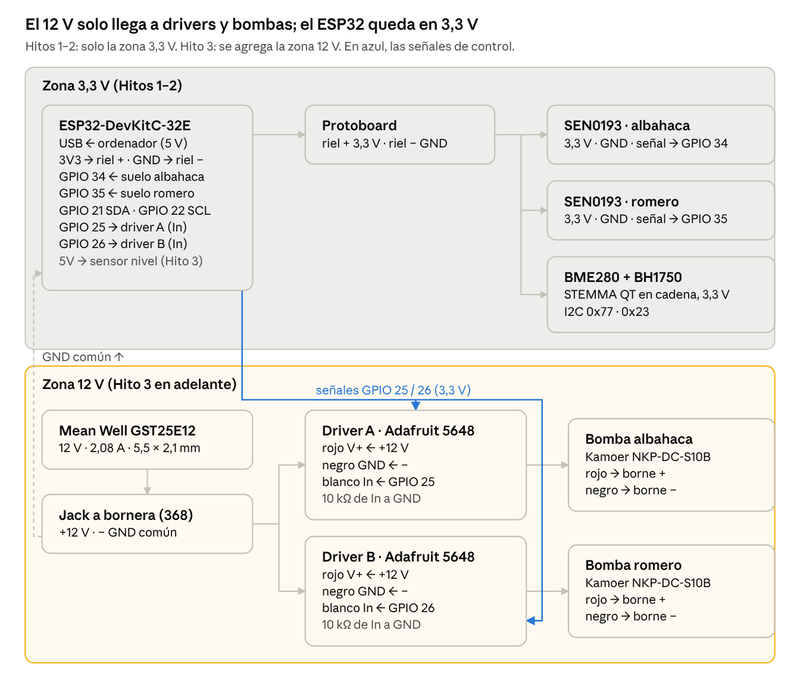
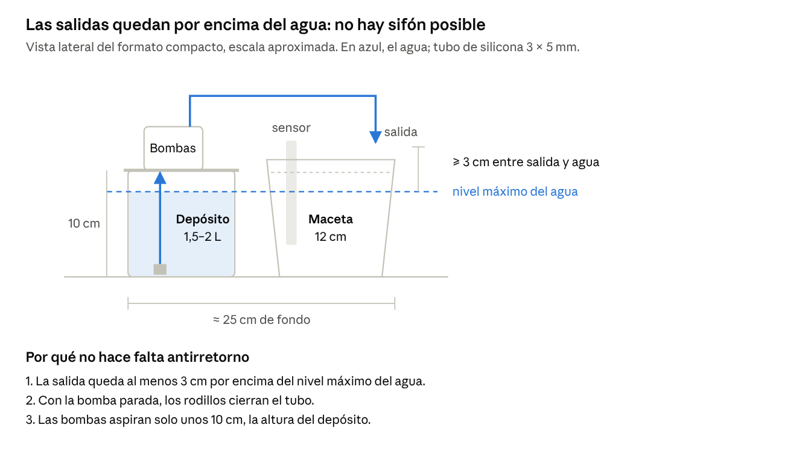
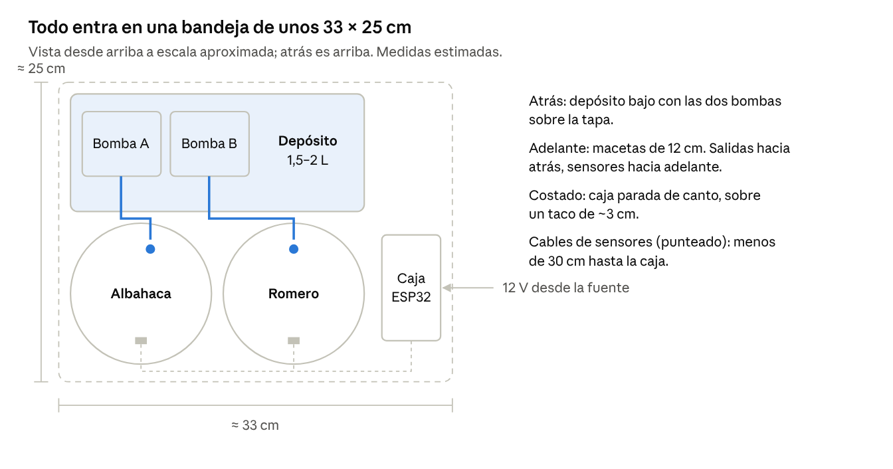

# Plant OS — Documento de continuidad v0.2

8 de noviembre de 2026 · Felipe

> Copia exportada del documento vivo: https://claude.ai/artifact/JRH5co8aA3JUmFBgptsdu8
> Si hay diferencias, la versión de este repo es la que acompaña al código del mismo commit.

## Estado actual

Las decisiones hidráulicas pendientes están cerradas. La BOM está elegida con modelos concretos, se arma sin soldar y casi toda sale de un solo distribuidor de la UE. El firmware y las pruebas de los Hitos 1 y 2 están listos. **Siguiente paso: comprar y montar el Hito 1.**

Cambios respecto a v0.1:

- **Driver de bombas:** se reemplaza el MOSFET suelto por el módulo Adafruit 5648, que ya trae MOSFET, diodo flyback y borneras de tornillo. Es lo más seguro para armar sin soldar.
- **Bomba:** de candidata pasa a modelo cerrado, Kamoer NKP-DC-S10B (12 V, tubo de silicona 3 × 5 mm).
- **Límite de seguridad por evento:** `MAX_WATERING_MS = 10000` (10 s) daría solo unos 12–13 ml con esta bomba. Es poco incluso para una maceta de 12 cm, así que los límites pasan a definirse en ml (por evento y por día) con el caudal calibrado.
- **Alimentación en V0.1:** el ESP32 se alimenta por USB y las bombas por una fuente de 12 V aparte, con GND común. El regulador de 5 V queda fuera de V0.1.

**Formato compacto (actualizado el 8-nov-2026):** macetas de 12 cm y todo en un solo nivel. El conjunto entra en unos **32 × 25 cm de base y 35–45 cm de alto con las plantas** [Estimación], contra 50 × 25 × 70 cm de la primera versión. Cambian el depósito, las macetas, la protoboard y la ubicación de la electrónica. Los componentes electrónicos, las bombas y el firmware no cambian.

En todo el documento se usan tres etiquetas: **[Confirmado]** = dato de la ficha del fabricante o el distribuidor, consultada el 8-nov-2026. **[Estimación]** = cálculo o valor típico que hay que medir. **[Supuesto]** = decisión de ingeniería que se revisa con datos.

## Decisiones hidráulicas cerradas

Decisiones actualizadas el 8-nov-2026: macetas de **12 cm**, todo en **un solo nivel**, con un depósito **bajo y largo detrás de las macetas**, y **agua corriente**. La salida de cada tubo queda más alta que el nivel máximo del agua, así que no puede haber sifón y en V0.1 siguen sin hacer falta válvulas antirretorno. Esto reemplaza la primera versión (depósito debajo y macetas de 15–20 cm), que ocupaba unos 50 × 25 × 70 cm.

| Tema | Decisión V0.1 | Por qué | Etiqueta |
| --- | --- | --- | --- |
| Disposición | Un solo nivel: macetas adelante, depósito detrás, caja de electrónica al costado | Elimina el segundo nivel de la repisa | Ver «Disposición compacta» |
| Sifón y válvulas antirretorno | No se instalan | La punta de salida queda al menos 3 cm por encima del nivel máximo del agua, así que no puede hacer sifón. Además, los rodillos aprietan el tubo cuando la bomba está parada | [Supuesto] Marcar el nivel máximo en el depósito y verificar en el Hito 3 con 24 h sin regar |
| Depósito | 1,5–2 L, bajo (10 cm de alto como máximo) y largo (~25 × 10 cm de base), opaco, con tapa, apto para alimentos | Al ser bajo, el agua queda siempre por debajo de las salidas. Lo opaco evita algas. Los tubos entran por la tapa | [Supuesto] Hay que recargarlo más seguido que uno de 3–5 L; el consumo real se mide en el Hito 8 |
| Posición de las bombas | Sobre la tapa del depósito, sujetas con cinta doble faz o precintos | Aspiración de unos 10 cm, solo la altura del depósito, y tubos cortos | [Estimación] Kamoer la publica como autocebante; la altura de aspiración se mide en el Hito 3 |
| Posición de la electrónica | Caja de ~12 × 9 × 5 cm parada de canto al costado de las macetas, sobre un taco o patas de ~3 cm | Queda separada del depósito, y una fuga sobre la mesa no le llega | [Supuesto] |
| Macetas | 12 cm de diámetro, ~11 cm de alto, con drenaje y plato | Es lo mínimo para que el SEN0193 (9,8 cm de largo) entre hasta su línea con tierra alrededor | [Estimación] Con 10 cm el sensor queda muy justo |
| Filtro de entrada | Peso con rejilla en la punta de cada tubo de aspiración | Con agua corriente basta con que el tubo quede en el fondo y no chupe partículas | [Supuesto] |
| Salida | Punta del tubo sujeta con una estaca a 1–2 cm del sustrato, del lado opuesto al sensor | Si el agua cae sobre el sensor, la lectura queda sesgada | [Supuesto] |
| Dosis por riego | Se determina midiendo, en pasos de 20 ml | Una maceta chica tiene menos sustrato: dosis más chicas y más frecuentes | Procedimiento en «Pendientes» |
| Límites de seguridad | En ml: máximo por evento y por día para cada planta, convertidos a tiempo con el caudal calibrado | A ~70–80 ml/min, 20 ml son unos 15–17 s | [Estimación] Caudal publicado ≥ 70–80 ml/min; se calibra |
| Tiempo máximo de bomba encendida | 5 min por evento como techo duro de firmware | Es una red de seguridad: con macetas de 12 cm, el límite real en ml va a cortar mucho antes | [Supuesto] |
| Tubo | Silicona apta para alimentos, 3 mm interior × 5 mm exterior | Medida del tubo de la NKP-DC-S10B. Con el formato compacto alcanzan unos 3 m | [Confirmado] 3,0 × 5,0 mm según la ficha del producto |

## BOM definitiva V0.1

Todo se arma **sin soldar**: módulos con borneras, conectores STEMMA y cables con pines. La electrónica sale de un pedido a **Mouser** (más respaldo en **BerryBase**, que tiene tienda en Austria). La bomba es de Kamoer y lo hidráulico es material de ferretería. Precios y stock vistos el 8-nov-2026: pueden cambiar, así que revisalos al comprar.

### Pedido 1 — Electrónica (Mouser; respaldo BerryBase)

| # | Componente | Modelo exacto | Cant. | Dónde | Visto el 8-nov-2026 |
| --- | --- | --- | --- | --- | --- |
| 1 | Controlador | Espressif **ESP32-DevKitC-32E** (WROOM-32E, 4 MB, micro-USB, pines ya soldados) | 1 | [Mouser 356-ESP32-DEVKITC32E](https://www.mouser.fr/en/ProductDetail/356-ESP32-DEVKITC32E) · respaldo [Elektor](https://elektor.com/esp32-devkitc-32e) | Mouser: €8,78 sin IVA, 1.700 en stock · Elektor: €14,95 con IVA |
| 2 | Humedad de suelo | **DFRobot SEN0193** (capacitivo, 3,3–5,5 V, salida analógica, incluye cable) | 3 (1 de repuesto) | Mouser 426-SEN0193 · [ficha DFRobot](https://wiki.dfrobot.com/sen0193/) | Mouser: >100 en stock según sus listados · BerryBase.at: sin stock |
| 3 | Driver de bomba | **Adafruit 5648** MOSFET Driver (AO3406 + diodo 1N4007, borneras, JST PH) | 3 (1 de repuesto) | Mouser 485-5648 · [BerryBase](https://www.berrybase.de/en/adafruit-cqa240327p-mosfet-driver-jst-ph-2mm-ao3406-mosfet-1n4007-diode-3-30v) | Mouser: €3,40, 96 en stock · BerryBase: €3,90 con IVA, 100+ |
| 4 | Temp. y humedad ambiente | **Adafruit 2652** BME280 (STEMMA QT) | 1 | [BerryBase.at](https://www.berrybase.at/en/adafruit-bme280-i2c-or-spi-temperature-humid.-pressure-sensor) · Mouser 485-2652 | BerryBase.at: €16,90 con IVA, 100+ · Mouser: sin verificar |
| 5 | Luz | **Adafruit 4681** BH1750 (STEMMA QT) | 1 | Mouser 485-4681 · [BerryBase.at](https://www.berrybase.at/en/adafruit-bh1750-light-sensor-stemma-qt-qwiic) | Mouser: €3,87, 70 en stock · BerryBase.at: €4,50, 10 |
| 6 | Cable I2C entre sensores | Adafruit 4210 STEMMA QT 100 mm | 1 | Mouser | Sin verificar |
| 7 | Cable I2C a protoboard | Adafruit [4209](https://adafruit.com/product/4209) STEMMA QT a pines macho | 1 | Mouser · Kiwi Electronics (NL) | Kiwi: €0,95 sin IVA, 65 en stock |
| 8 | Cable de señal de los drivers | Adafruit [3893](https://www.adafruit.com/products/3893) JST PH 3 pines a pines macho, 200 mm | 3 | Mouser | Sin verificar |
| 9 | Nivel del depósito (Hito 3) | **DFRobot SEN0204** sin contacto (XKC-Y25-T12V) | 1 | Mouser / Farnell | Sin verificar |
| 10 | Fuente de bombas | **Mean Well GST25E12-P1J** 12 V 2,08 A, enchufe EU, plug 5,5 × 2,1 mm centro positivo | 1 | Mouser / RS | Ficha confirmada, stock sin verificar |
| 11 | Jack DC a bornera | Adafruit 368 (hembra 2,1 mm a tornillo) | 1 | Mouser | [Supuesto] ID de producto a confirmar al pedir |
| 12 | Protoboard | Media protoboard de 400 puntos (por ejemplo, Adafruit 64) | 1 | Mouser / BerryBase | — |
| 13 | Cables Dupont | Set M-M, H-M y H-H de 20 cm (BerryBase DUPK-SET-20) | 1 | BerryBase | €4,90 con IVA, en stock |
| 14 | Resistencias | 10 kΩ × 2 (pull-down de los gates) + 33 kΩ × 1 (sensor de nivel) | kit | Cualquier kit de resistencias | — |
| 15 | Cable USB | Micro-USB **de datos** (no solo de carga) | 1 | — | — |
| 16 | Herramienta | Multímetro con continuidad sonora | 1 | Cualquiera | Imprescindible: lo uso en varias verificaciones |

### Pedido 2 — Bombas

| # | Componente | Modelo exacto | Cant. | Dónde | Visto el 8-nov-2026 |
| --- | --- | --- | --- | --- | --- |
| 17 | Bomba peristáltica | **Kamoer NKP-DC-S10B** — 12 V DC, ≥ 70–80 ml/min, 5 W máx., silicona 3 × 5 mm, 0,25 A de consumo publicado | 2 (+1 de repuesto opcional) | Amazon (ASIN B07GWJ78FN en amazon.com) o tienda oficial de Kamoer | No pude verificar una ficha en Amazon.de. Buscá por el modelo exacto **NKP-DC-S10B**: hay variantes S04/S06/S08 con otro caudal y otro tubo |

La candidata de v0.1 (GroLab NKP en opengrow.pt) tiene la misma familia de cabezal. La página me bloqueó y no pude confirmar sus datos, así que queda solo como alternativa.

### Pedido 3 — Hidráulica y plantas (ferretería, supermercado, vivero)

| # | Componente | Especificación | Cant. |
| --- | --- | --- | --- |
| 18 | Tubo | Silicona apta para alimentos, 3 mm × 5 mm | 3 m |
| 19 | Depósito | 1,5–2 L, rectangular, bajo (10 cm de alto como máximo), ~25 × 10 cm de base, opaco, con tapa, apto para alimentos | 1 |
| 20 | Peso de aspiración | Tuerca inoxidable de M5 o M6 + malla plástica fina, una por tubo | 2 |
| 21 | Salida | Estaca o pinza de planta para sujetar la punta del tubo | 2 |
| 22 | Macetas | 12 cm de diámetro, con agujero de drenaje, cada una con su plato | 2 |
| 23 | Plantas | 1 albahaca + 1 romero, de tamaño para maceta de 12 cm; idealmente 2 + 2 para tener control manual | 2–4 |
| 24 | Sustrato | Bien drenado; para el romero, más drenante | — |
| 25 | Caja de electrónica | Caja plástica con tapa de ~12 × 9 × 5 cm + taco o patas de ~3 cm | 1 |
| 26 | Montaje | Bandeja de ~35 × 25 cm para todo el conjunto, precintos, cinta doble faz | — |

**Fusibles:** v0.1 pedía 2 fusibles. Los portafusibles en línea requieren crimpar o soldar, así que los **difiero a V0.2**, cuando el montaje pase a bornera definitiva. Mientras tanto, la protección es que la fuente entrega 2,08 A como máximo (que tenga protección contra cortocircuito es un [Supuesto] a verificar en la hoja de datos de la GST25E) y que el firmware nunca enciende las dos bombas a la vez. [Supuesto] Decisión a confirmar por vos.

## Verificación de compatibilidad

Todas las interfaces son compatibles. Hay **un riesgo crítico de cableado**: el cable rojo del conector JST del driver Adafruit 5648 es V+ (la alimentación de la carga). En este sistema lleva **12 V** y no debe tocar nunca el 3V3 del ESP32. La fila marcada con ⚠ explica cómo comprobarlo antes de energizar.

| Interfaz | Requisito | Dato | Resultado |
| --- | --- | --- | --- |
| GPIO 25/26 (3,3 V) → entrada In del 5648 | Que 3,3 V active el MOSFET | La señal In acepta de 2,5 a 20 V [Confirmado, guía Adafruit] | ✔ Compatible, sin adaptar niveles |
| ⚠ Cable rojo V+ del JST del 5648 | Saber a qué va conectado | Adafruit describe V+ como «power» de 3 a 30 V, y la bornera «+» como conectada a power. En sus ejemplos alimenta la carga por ese mismo cable [Confirmado]. Que V+ y el borne «+» sean el mismo nodo es [Supuesto] | Antes de energizar, comprobá con el multímetro, en modo continuidad, el pin rojo del JST contra el borne «+»: debe sonar. Así, rojo = 12 V. **Nunca al ESP32** |
| Carga del 5648 vs. bomba | Corriente de la bomba muy por debajo del límite | 5648: 1,5 A continuos, 3 A de pico [Confirmado]. NKP-DC-S10B: 0,25 A publicados, 5 W máx. ≈ 0,42 A [Confirmado / Estimación] | ✔ Margen de más de 3× |
| Protección inductiva | Diodo flyback por motor | 1N4007 en la placa [Confirmado] | ✔ Suficiente para encendido/apagado sin PWM, que es el modo de V0.1 |
| Estado de las bombas al arrancar | Bombas apagadas tras cualquier reinicio | GPIO 25/26 no son pines de arranque (strapping). La guía no menciona un pull-down en In | Se agrega 10 kΩ de In a GND en la protoboard, y el firmware pone LOW en la primera línea |
| Fuente 12 V vs. dos bombas | Corriente con margen, incluido el arranque | GST25E12: 2,08 A [Confirmado]. 2 bombas ≈ 0,5–0,85 A en marcha más el pico de arranque [Estimación] | ✔ El firmware igual enciende una sola bomba por vez |
| GND | Referencia común | — | Un cable de la bornera «−» de 12 V al GND del ESP32 |
| SEN0193 → ADC (GPIO 34/35) | La salida no supera 3,3 V y cae en un rango útil | Alimentación de 3,3 a 5,5 V. Salida de 0 a 3,0 V según DFRobot; algunos distribuidores dicen 1,2–2,5 V [Confirmado] | ✔ Se alimenta a 3,3 V. Atenuación de 11 dB. El rango real se mide en el Hito 1 [Supuesto] |
| ADC1 y Wi-Fi | Que las lecturas sigan con Wi-Fi activo | GPIO 34/35 son del ADC1; el ADC2 no funciona con Wi-Fi | ✔ |
| I2C | Sin conflicto de direcciones, y funcionamiento a 3,3 V | BME280 0x77 y BH1750 0x23 (valores por defecto de Adafruit). Las dos placas tienen regulador y adaptación de niveles [Confirmado] | ✔ Conexión en cadena con STEMMA QT |
| Cable STEMMA QT → ESP32 | Colores | Rojo 3,3 V, negro GND, azul SDA, amarillo SCL [Confirmado, Adafruit 4209] | Azul a GPIO 21, amarillo a GPIO 22 |
| SEN0204 (nivel) → ESP32 | Que la entrada no supere 3,3 V | Alimentación de 5 a 24 V; la salida en alto es igual a la alimentación [Confirmado], es decir ≥ 5 V | ✘ No va directo. Resistencia de 33 kΩ de OUT a GND, alimentado a 5 V; según un usuario, con la resistencia interna de 20 kΩ queda ≈ 3,1 V. **Medir antes de conectarlo al GPIO** (Hito 3) |
| ESP32-DevKitC en la protoboard | Acceso a los pines de los dos lados | La placa mide 54,4 × 27,9 mm [Confirmado]. En una protoboard estándar solo queda libre un lado | El ESP32 queda fuera de la protoboard y se conecta con cables Dupont hembra-macho |
| Fuente → jack | Plug y polaridad | GST25E12: 5,5 × 2,1 mm, centro positivo [Confirmado]. Adafruit 368: jack de 2,1 mm [Supuesto] | ✔ Verificar la polaridad con el multímetro en la bornera: + = rojo |
| Tubo de la bomba ↔ tubo de extensión | Mismo diámetro y sin fugas | Las dos medidas son 3 × 5 mm [Confirmado] | Al recibir la bomba, ver si el cabezal acepta un tramo continuo, sin uniones. Si no, usar uniones rectas dentadas para tubo de 3 mm de diámetro interior |
| Cable del SEN0193 | Distancia entre la maceta y la protoboard | El cable incluido mide unos 30 cm según un distribuidor [Estimación] | Las macetas quedan a menos de 30 cm de la protoboard, o se prolonga con cables Dupont |

## Diagrama eléctrico

El 12 V entra por el cable rojo del JST de cada driver y sale por sus borneras hacia la bomba. El ESP32 solo aporta la señal de 3,3 V y comparte GND con la fuente.

| Desde | Hacia | Cable | Hito |
| --- | --- | --- | --- |
| ESP32 3V3 | Riel + de la protoboard | Dupont hembra-macho | 1 |
| ESP32 GND | Riel − de la protoboard | Dupont hembra-macho | 1 |
| SEN0193 albahaca VCC / GND / señal | Riel + / riel − / GPIO 34 | Cable Gravity incluido + Dupont | 1 |
| SEN0193 romero VCC / GND / señal | Riel + / riel − / GPIO 35 | Cable Gravity incluido + Dupont | 1 |
| BME280 ↔ BH1750 | — | STEMMA QT 100 mm (4210) | 2 |
| STEMMA QT rojo / negro / azul / amarillo | Riel + / riel − / GPIO 21 / GPIO 22 | STEMMA QT a pines (4209) | 2 |
| Fuente GST25E12 | Jack a bornera (368) | Plug 5,5 × 2,1 mm | 3 |
| Bornera +12 V | Rojo (V+) del JST de los drivers A y B | Adafruit 3893 | 3 |
| Bornera − | Negro (GND) del JST de los drivers A y B, y GND del ESP32 | 3893 + Dupont | 3 |
| GPIO 25 / GPIO 26 | Blanco (In) del JST del driver A / B | 3893 + Dupont | 3 |
| In de cada driver | GND, con 10 kΩ | Resistencia en la protoboard | 3 |
| Borne + / borne − del driver A | Rojo / negro de la bomba albahaca | Cables de la bomba | 3 |
| Borne + / borne − del driver B | Rojo / negro de la bomba romero | Cables de la bomba | 3 |
| SEN0204 VCC / GND / OUT | ESP32 5V / GND / GPIO 27, con 33 kΩ de OUT a GND | Gravity + Dupont | 3, después de medir |

## Diagrama hidráulico

Cada bomba tiene su propio tubo de aspiración, que entra al depósito por la tapa, y su propia salida. No hay uniones por debajo del nivel del agua ni válvulas. Marcá con un fibrón el nivel máximo en el depósito y no lo llenes por encima: esa marca es lo que garantiza que no haya sifón.

## Disposición compacta

Con macetas de 12 cm, el conjunto ocupa unos 33 × 25 cm y llega a 35–45 cm de alto con las plantas [Estimación]. Las salidas van hacia el depósito y los sensores hacia adelante, así el riego no cae sobre el sensor. La caja queda a menos de 30 cm de los dos sensores, que es lo que alcanza el cable incluido.

## Montaje paso a paso: Hitos 1 y 2

En los Hitos 1 y 2 **no se enchufa la fuente de 12 V ni se conectan bombas**: todo funciona con 3,3 V que el ESP32 toma del USB. Regla para todos los hitos: **desenchufá el USB antes de mover cualquier cable**.

### Hito 1 — Sensores de humedad de suelo

1. **Ordenador.** Instalá VS Code y la extensión PlatformIO, y abrí la carpeta `firmware/` del repositorio `plant-os` (detalles en su README). Ejecutá `pio test -e native`: tiene que dar 17 pruebas sin fallos.
2. **ESP32 solo.** Conectá el DevKitC por USB, sin nada más conectado. Cargá el firmware con `pio run -e m1_soil -t upload` y abrí `pio device monitor`. Con los pines al aire, el estado **no** debe decir `OK`: así se comprueba que la validación detecta un sensor ausente.
3. **Rieles de la protoboard.** Desenchufá el USB. Con cables hembra-macho: pin **3V3** del ESP32 al riel rojo (+) y pin **GND** al riel azul (−). Volvé a enchufar el USB y medí con el multímetro entre los rieles: ≈ 3,3 V. Desenchufá.
4. **Sensor 1 (albahaca).** Cable del SEN0193: VCC → riel +, GND → riel −, señal → **GPIO 34**. Antes de conectar, verificá qué color es cada señal leyendo la serigrafía de la placa del sensor (VCC / GND / AOUT); no te guíes solo por los colores. El sensor no se moja nunca por encima de la línea marcada.
5. **Calibrar el sensor 1.** Enchufá el USB. Con el sensor al aire, limpio y seco, escribí `d1`. Ponelo en un vaso de agua hasta la línea y escribí `w1`. La calibración debe quedar `VALID` (seco − agua ≥ 300 mV).
6. **Sensor 2 (romero).** Desenchufá. Cablealo igual, pero con la señal a **GPIO 35**. Calibralo con `d2` y `w2`.
7. **Pruebas de aprobación.** Hacé el test de estabilidad (`s`) en tierra húmeda, la prueba de respuesta (regar sustrato seco) y la prueba cruzada (mover solo un sensor). Criterios en «Firmware y pruebas».
8. **Guardá los datos.** Copiá la salida CSV del monitor y la calibración (`c`). Son la línea de base para el Decision Engine.

### Hito 2 — Variables ambientales

1. **Encadenar los sensores.** Desenchufá el USB. Uní el BME280 y el BH1750 con el cable STEMMA QT de 100 mm (Adafruit 4210).
2. **A la protoboard.** Conectá el cable STEMMA QT a pines (Adafruit 4209) en el conector libre de cualquiera de los dos: **rojo** → riel + (3,3 V), **negro** → riel −, **azul** → **GPIO 21** (SDA), **amarillo** → **GPIO 22** (SCL). Los sensores del Hito 1 pueden quedar conectados.
3. **Cargar y comprobar.** Cargá el firmware con `pio run -e m2_environment -t upload`. El escaneo I2C debe mostrar `0x23` y `0x77`, y el BME280 debe informar chip id `0x60`.
4. **Pruebas de aprobación.** Compará con un termómetro, tapá el BH1750 con la mano y apuntale con una linterna, y desconectá y reconectá el cable STEMMA QT.
5. **Ubicación definitiva.** El BME280 va a más de 10 cm del ESP32, porque el regulador y el módulo Wi-Fi calientan [Supuesto]. El BH1750 va a la altura de las hojas, mirando hacia la fuente de luz.

### Antes del Hito 3 (bombas), no avanzar sin:

- [ ] Hito 1 aprobado con los dos sensores calibrados
- [ ] Hito 2 aprobado
- [ ] Continuidad entre el pin rojo del JST y el borne «+» de cada 5648 comprobada con el multímetro
- [ ] Polaridad de la bornera de 12 V medida (+ = 12 V)
- [ ] Pull-down de 10 kΩ colocado en las entradas In de los dos drivers

## Firmware y pruebas

El firmware vive en la carpeta `firmware/` del repositorio `fmaliarbot/plant-os` y tiene un entorno de PlatformIO por hito. Todo el código (identificadores, comentarios y salida serie) está en inglés. La lógica de decisión (filtro, calibración, validación) está separada en una librería pura con **17 pruebas unitarias que pasan**. GitHub Actions compila los dos firmwares del ESP32 y corre las pruebas en cada push que toca `firmware/`.

| Entorno | Prueba | Salida |
| --- | --- | --- |
| `native` | Mediana, percentiles, calibración, índice 0–100, validación y estadística | `17 Tests 0 Failures` |
| `m1_soil` | 2 × SEN0193: ráfaga de 31 muestras cada 2 s, calibración seco/agua guardada en la flash, test de estabilidad | CSV `t_ms,plant,mv,spread_mv,index,status` |
| `m2_environment` | BME280 + BH1750: escaneo I2C, comprobación de chip id y reintento si un sensor se desconecta | CSV `t_ms,temp_c,rh_pct,pressure_hpa,lux,bme_status,lux_status` |

Decisiones de diseño del firmware:

- **Seguridad primero:** `pumps_force_off()` es la primera línea de `setup()` en todos los hitos. Fija el nivel LOW antes de habilitar la salida.
- **Sin bloqueos largos:** el loop usa `millis()`. La única espera es la ráfaga de lectura, de unos 25 ms.
- **Lectura robusta:** se toma la mediana de 31 muestras, así un pico aislado no mueve el valor. La dispersión p90 − p10 se informa como medida de ruido.
- **Validación explícita:** cada lectura sale con un estado (`OK`, `UNCALIBRATED`, `LOW_IMPLAUSIBLE`, `HIGH_SATURATED`, `NOISY`). El Decision Engine solo podrá regar con `OK`.
- **El índice 0–100 es relativo** a la calibración de cada sensor. No es % de humedad volumétrica, y no se comparan valores entre los dos sensores.

### Criterios de aprobación

Los umbrales son **[Supuesto]**: se ajustan con los datos que midas.

| Hito | Prueba | Pasa si |
| --- | --- | --- |
| 1 | Sin sensor conectado | El estado no es `OK` |
| 1 | Calibración seco/agua | Seco − agua ≥ 300 mV y calibración `VALID` |
| 1 | Estabilidad (`s`, 60 s, en tierra húmeda) | Desvío ≤ 15 mV (`STABLE`) |
| 1 | Respuesta | El índice sube unos minutos después de regar sustrato seco |
| 1 | Cruzada | Al mojar solo el sensor 1, el 2 no cambia |
| 2 | Bus I2C | Aparecen `0x23` y `0x77`, chip id `0x60` |
| 2 | Temperatura | Dentro de ±2 °C de un termómetro de referencia [Estimación] |
| 2 | Luz | Lux ≈ 0 tapado con la mano; sube mucho con una linterna |
| 2 | Desconexión | El estado pasa a error y se recupera solo al reconectar |

## Pendientes y próximos pasos

Lo próximo es comprar los tres pedidos y aprobar los Hitos 1 y 2. Después viene el Hito 3, para el que hay que preparar su firmware.

Decisiones que te tocan a vos:

- [ ] Confirmar que los fusibles se difieren a V0.2 (justificación en la BOM)
- [ ] Confirmar el vendedor de la Kamoer NKP-DC-S10B para Austria (Amazon.de o la tienda oficial) y que el modelo sea exactamente S10B
- [ ] Indicar el sistema operativo del ordenador de desarrollo; el README cubre Windows, macOS y Linux

Hito 3, a preparar cuando 1 y 2 estén aprobados:

1. **Firmware de prueba de bombas:** temporización no bloqueante, bloqueo para que nunca funcionen las dos a la vez, límite duro de 5 min por evento y comandos por serie para dosificar en ml.
2. **Calibración de caudal (procedimiento de v0.1):** 30 s de bomba × 5 repeticiones sobre un recipiente graduado, por bomba. Se guarda el caudal medio en ml/min. Las fichas dicen ≥ 70–80 ml/min y un usuario reportó ±15 % de variación entre unidades [Estimación], así que la calibración individual es obligatoria.
3. **Aspiración:** con el depósito abajo, medir cuánto tarda en cebar y si ceba con el depósito casi vacío.
4. **Reinicio tras reposo:** un usuario reportó que su NKP no volvió a girar después de 12 h parada. Probar el arranque tras 24 h quieta.
5. **Antisifón y fugas:** 24 h sin riego, sin goteo en las salidas y sin humedad en las uniones.
6. **Sensor de nivel:** medir la tensión de OUT con la resistencia de 33 kΩ antes de conectarlo al GPIO 27. Debe quedar por debajo de 3,3 V.
7. **Dosis de referencia por maceta:** con el sustrato seco al tacto, regar en pasos de 20 ml hasta que gotee por el drenaje. Anotar el volumen total y el índice antes y después. Esto define los límites en ml por evento y por día de cada planta.

Los Hitos 4 a 8 (firmware con comunicación, backend, dashboard, automatización y prueba real) siguen como en v0.1. **No se automatiza nada hasta que sensores y bombas pasen sus pruebas individuales.**

## Fuentes

Páginas consultadas el 8-nov-2026.

- [Adafruit 5648 — ficha del producto](https://www.adafruit.com/product/5648) · [guía: pinout](https://learn.adafruit.com/adafruit-mosfet-driver/pinouts) · [guía completa](https://learn.adafruit.com/adafruit-mosfet-driver?view=all)
- [Adafruit 5648 en BerryBase](https://www.berrybase.de/en/adafruit-cqa240327p-mosfet-driver-jst-ph-2mm-ao3406-mosfet-1n4007-diode-3-30v)
- [DFRobot SEN0193 — wiki](https://wiki.dfrobot.com/sen0193/)
- [ESP32-DevKitC-32E en Mouser](https://www.mouser.fr/en/ProductDetail/356-ESP32-DEVKITC32E) · [Elektor](https://elektor.com/esp32-devkitc-32e)
- [Adafruit BME280 en BerryBase.at](https://www.berrybase.at/en/adafruit-bme280-i2c-or-spi-temperature-humid.-pressure-sensor)
- [Adafruit BH1750 en BerryBase.at](https://www.berrybase.at/en/adafruit-bh1750-light-sensor-stemma-qt-qwiic)
- [Adafruit 4209 — colores del cable STEMMA QT](https://adafruit.com/product/4209) · [Adafruit 3893](https://www.adafruit.com/products/3893)
- [DFRobot SEN0204 — especificaciones (robot-domestici)](https://website.robot-domestici.it/product/15304-gravity-non-contact-digital-liquid-level-sensor-for-arduino) · [nota de uso a 3,3 V (RobotShop)](https://www.robotshop.com/es/products/gravity-non-contact-liquid-level-sensor)
- [Mean Well GST25E12-P1J en RS](https://uk.rs-online.com/web/p/ac-dc-adapters/1176178)
- [Kamoer NKP-DC-S10B — especificaciones y reseñas (listado de amazon.com replicado en Desertcart)](https://www.desertcart.ma/products/78346192-low-flow-peristaltic-pump-12v-dc-kamoer-nkp-diy-liquid) · [consumo de 0,25 A (Robu)](https://stg.robu.in/?p=1005089)
